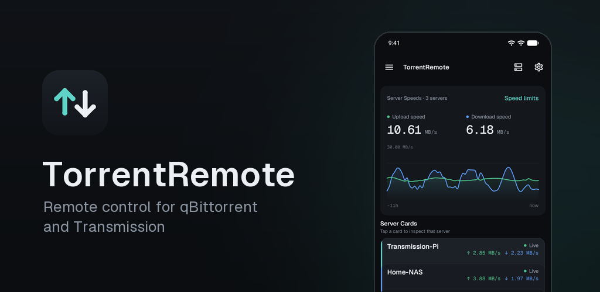
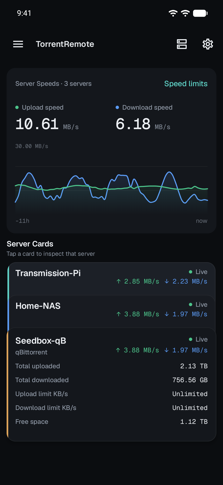
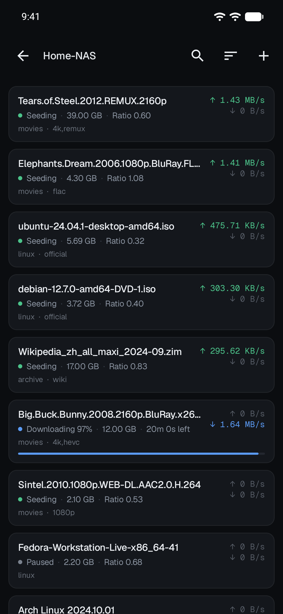
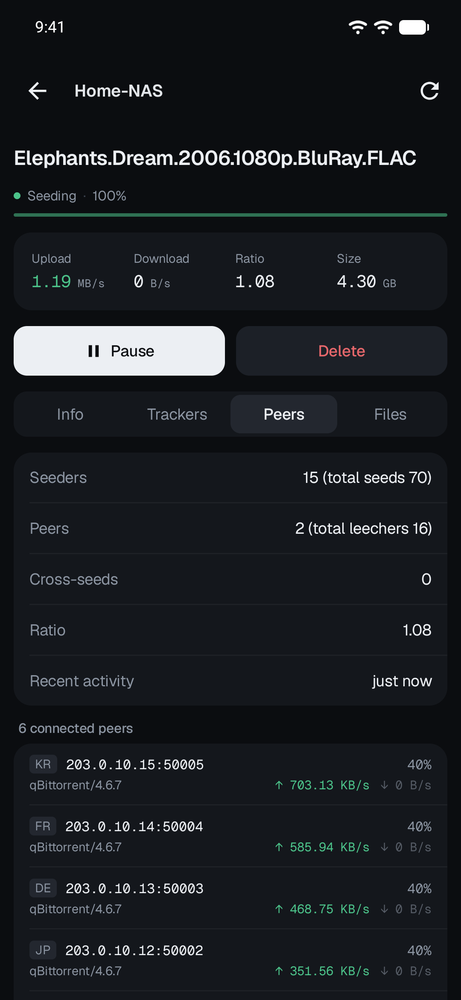
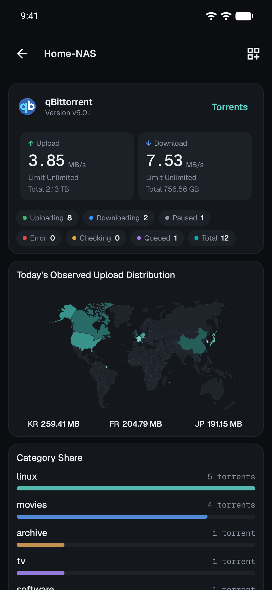
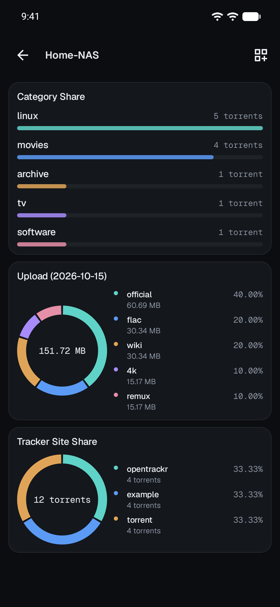

<div align="center">



# TorrentRemote

**在一部手机上管理你所有的 qBittorrent 与 Transmission 服务器。**

[English](README.md) | **简体中文**

[](https://github.com/smhjw/qbitremote/actions/workflows/ci.yml)
[](https://github.com/smhjw/qbitremote/releases)


</div>

---

TorrentRemote 是一款原生 Android 应用（Kotlin + Jetpack Compose），用于远程管理种子下载。首页汇总所有服务器的实时速度，每台服务器有独立的图表仪表盘，种子列表与详情页覆盖日常管理的全部操作。qBittorrent 与 Transmission 服务器可以在同一界面里混用。

## 应用截图

<table>
  <tr>
    <td align="center"><br /><sub>首页：所有服务器一目了然</sub></td>
    <td align="center"><br /><sub>种子列表</sub></td>
    <td align="center"><br /><sub>种子详情</sub></td>
  </tr>
  <tr>
    <td align="center"><br /><sub>服务器仪表盘与上传地图</sub></td>
    <td align="center"><br /><sub>分类、标签与站点图表</sub></td>
    <td></td>
  </tr>
</table>

## 功能

### 多服务器，一个应用
- 同时支持 qBittorrent WebUI API（4.x / 5.x）与 Transmission RPC，旧版本接口自动降级适配
- 可保存多台服务器配置，每台独立缓存快照，离线时仍显示最后一次数据
- 连不上的服务器按指数退避重试；应用退到后台自动暂停轮询，省电省流量

### 首页与仪表盘
- 全部服务器的上下行速度汇总与实时曲线，服务器卡片可长按拖动排序
- 每台服务器独立仪表盘：今日上传世界地图、分类占比、标签上传量、Tracker 站点、状态、分享率与体积分布
- 仪表盘卡片可隐藏、可排序，布局按服务器分别记忆

### 种子管理
- 右滑暂停/继续、左滑删除；长按进入多选批量操作；下拉刷新
- 按状态、分类、标签筛选，支持搜索与 11 种排序
- 详情页分信息、Tracker、用户、文件四个页签：已连接用户列表、单文件下载优先级、重命名、移动、导出、重新汇报、重新校验
- Tracker 编辑/删除（passkey 自动隐藏）、辅种识别、单种限速与分享率限制
- 通过磁力链接、URL 或 `.torrent` 文件添加种子，也可从其他应用直接分享链接进来

### 限速
- 读取和修改全局限速与备用限速，包括定时计划（时段与星期）
- 多台服务器在线时，可在限速弹窗里直接切换目标服务器

### 设计与体验
- 克制简约的深色/浅色设计，数字使用等宽字体；也可设置自定义背景图
- 新版 Android 上支持全面屏（edge-to-edge）与预测性返回手势
- 种子下载完成通知，锁屏上只显示标题，保护隐私
- 支持简体中文与英文

### 安全
- 服务器凭据使用 Android Keystore（AES-GCM）加密存储，且不参与备份
- 通过明文 HTTP 连接公网地址时给出风险提示（局域网地址不提示）
- 发布版本经 R8 混淆压缩，并移除日志输出

## 系统要求

| | |
|---|---|
| Android | 8.0（API 26）及以上，目标平台 Android 16（API 36） |
| qBittorrent | 4.x / 5.x，需启用 WebUI |
| Transmission | 2.80+，需启用 RPC |

## 下载

- [Google Play](https://play.google.com/store/apps/details?id=com.hjw.qbremote)
- [GitHub Releases](https://github.com/smhjw/qbitremote/releases)：签名 APK，附 `SHA256SUMS-vX.Y.Z.txt` 校验和清单

预编译安装包不会提交到本仓库。下载后请对照每个版本附带的校验和清单核对文件。

## 从源码构建

```bash
./gradlew assembleDebug
```

只需要 JDK 17 与 Android SDK（`ANDROID_HOME`）。CI 会在每次推送时运行单元测试、Lint、调试构建与未签名发布构建。签名发布包通过 `scripts/build-release-aab.ps1` 构建，需要本地密钥库（见 [AGENTS.md](AGENTS.md)）。

## 作者

由 **蜂巢 @hjw666**（[个人主页](https://pting.club/users/hjw666)）独立开发与维护。

## 社区

感谢 [LINUX DO](https://linux.do) 社区的佬友们提供的反馈与支持。

## 许可证

详见 [LICENSE](LICENSE)。内置字体 Geist、Geist Mono 采用 SIL Open Font License，见 [licenses/](licenses/)。
